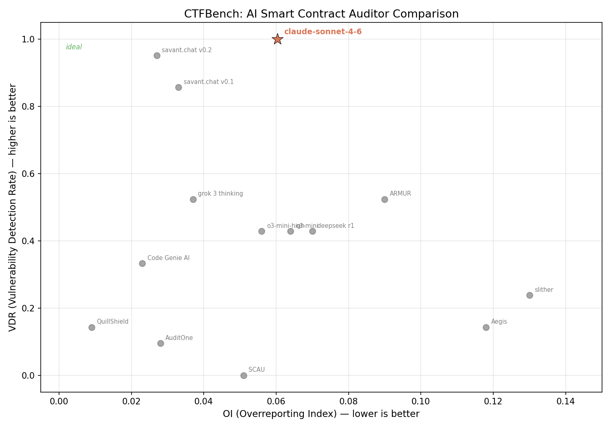

# CTFBench x Claude Code

Reproduction of [CTFBench](https://ctfbench.com/) using Claude models via the [Claude Agent SDK](https://github.com/anthropics/claude-agent-sdk-python).

## What is this?

[CTFBench](https://github.com/auditdbio/ctfbench) is a benchmark for AI smart contract auditors with 7 vulnerable contracts (each with exactly one injected bug) and 4 clean contracts. It measures:

- **VDR** (Vulnerability Detection Rate) — how many bugs the auditor finds
- **OI** (Overreporting Index) — false positive density on clean contracts

We ran Claude Sonnet 4.6 agents against all 11 contracts using the Claude Agent SDK and scored the results with the exact CTFBench judge prompts.

## Results

**Claude Sonnet 4.6: VDR = 1.000, OI = 0.060**

- Found all 7/7 vulnerabilities (perfect detection)
- Moderate false positive rate on clean contracts (no optimization done)



Full scores and reports are in `results/claude-sonnet-4-6/`.

## Key takeaways

**This benchmark is effectively saturated.** A one-shot Claude Code agent with zero prompt tuning achieves perfect vulnerability detection. The entire reproduction — code, agent runs, scoring — was built in about an hour with no optimization effort. Any team using a leading foundation model with a competent agentic framework can top this leaderboard trivially.

**The false positive rate (OI = 0.060) is the only remaining differentiator**, and we did nothing to optimize it. A simple deduplication or filtering pass would bring it down significantly. This is a solvable engineering problem, not a model capability gap.

**Tools not built on top of frontier models and modern agentic frameworks will fall behind very quickly.** The gap between purpose-built static analyzers and a general-purpose LLM agent with file-reading tools is already stark — and it will only widen as models improve.

## How to reproduce

```bash
uv sync
cp .env.example .env  # Add your Azure OpenAI key for the judge step

# Run everything (agents use your Claude Code subscription)
uv run python run.py all --model claude-sonnet-4-6
```

Individual steps:

```bash
uv run python run.py audit --model claude-sonnet-4-6  # Run 11 agents (~$2)
uv run python run.py judge --model claude-sonnet-4-6  # Score with LLM judge
uv run python run.py plot  --model claude-sonnet-4-6  # Generate scatter plot
```

## Attribution

- Benchmark contracts and methodology: [AuditdBio/ctfbench](https://github.com/auditdbio/ctfbench) (MIT License)
- Claude Agent SDK: [Anthropic](https://github.com/anthropics/claude-agent-sdk-python)
